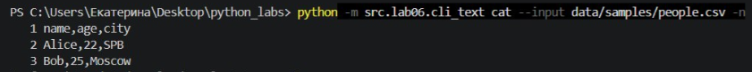
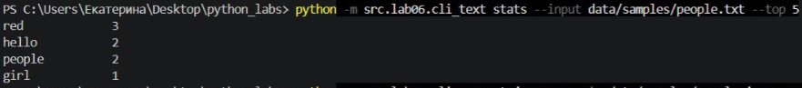
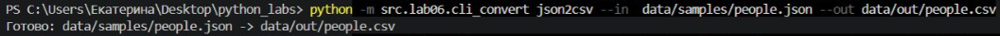
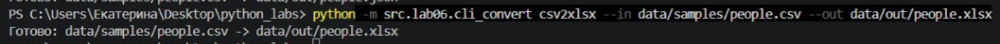
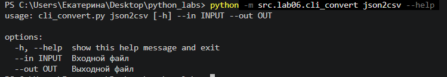
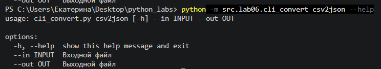
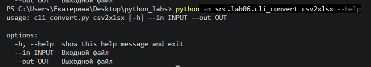

<h1><wbr>ЛР6 — CLI‑утилиты с argparse (cat/grep‑lite + конвертеры):  
Цель: Научиться создавать консольные инструменты с аргументами командной строки, подкомандами и флагами.
Связь: продолжение ЛР5 (работа с JSON/CSV/XLSX) и подготовка к ЛР7 (тестирование).
Основная задача — обернуть существующие функции конвертации и анализа текста в CLI‑оболочки с помощью argparse.

Результат ЛР
1. Модуль src/lab06/cli_text.py с подкомандами:

stats --input <txt></txt> [--top 5] — анализ частот слов в тексте (использовать функции из lab03);
cat --input <path></path> [-n] — вывод содержимого файла построчно (с нумерацией при -n).

2. Модуль src/lab06/cli_convert.py с подкомандами:

json2csv --in data/samples/people.json --out data/out/people.csv
csv2json --in data/samples/people.csv --out data/out/people.json
csv2xlsx --in data/samples/people.csv --out data/out/people.xlsx
(использовать функции из lab05)

